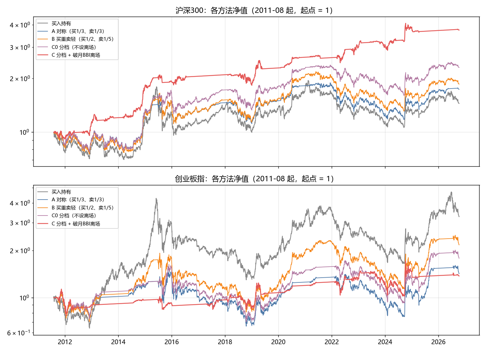

# A股顶底信号与情绪日报

这个项目从通达信本地日线数据出发，生成三类东西：

1. **通达信公式**：在日线图上直接标出顶底信号（★S、▽S、△B、★B）、月线 BBI 和"破月BBI"，副图显示分指数情绪指标。
2. **A股情绪日报**：每个交易日收盘后自动计算全市场情绪温度、融资和成交额过热分数、宽基 ETF 净申购（国家队）、涨跌家数、涨跌停，以及 8 个指数的情绪和信号。日报会生成本地网页，也可以同步到 claude.ai 的看板。
3. **研究和回测脚本**：信号是怎么设计和验证的，以及用这些信号管理仓位的回测。

> 以上全部是对历史数据的统计，不构成投资建议。

---

## 目录

- [环境准备](#环境准备)
- [安装通达信公式](#安装通达信公式)
- [每天使用日报](#每天使用日报)
- [信号说明](#信号说明)
- [日报里的指标](#日报里的指标)
- [回测结论](#回测结论)
- [文件结构](#文件结构)
- [数据来源和限制](#数据来源和限制)

---

## 环境准备

**需要的软件**

| 软件 | 用途 |
|---|---|
| Windows + 通达信金融终端 | 本地日线数据（`vipdoc` 目录）和公式显示 |
| Python 3.11 及以上 | 计算日报 |
| Python 包 | `pip install -r requirements.txt`（pandas、numpy、akshare、pyarrow、matplotlib） |

**通达信数据**

第一次使用前，在通达信里下载历史日线：`选项 → 盘后数据下载 → 日线和实时行情数据`，勾选全部 A 股和指数，从尽量早的日期开始下载。之后打开"日线自动写盘"，通达信开着时会自动保存每天的日线。

**路径**

项目默认通达信装在 `D:\TDXapp`，项目放在 `D:\TradingSignal`。如果不一样，需要修改下面这些地方：

| 文件 | 要改的内容 |
|---|---|
| `research/tdx_reader.py` | `VIPDOC = Path("D:/TDXapp/vipdoc")` |
| `research/build_breadth.py`、`daily/update.py` | `V = Path("D:/TDXapp/vipdoc")` |
| `daily/etf_shares.py`、`research/strategy_backtest.py`、`research/level3_buy.py` | 读取指数文件时写死的 `D:/TDXapp/vipdoc/...` |
| `更新情绪日报.bat` | `cd /d D:\TradingSignal` |

其他研究脚本里也有同样的写法，用到时一起替换即可。

**网络**

脚本会通过 akshare 访问新浪、上交所、中证指数等公开数据。如果电脑开着代理，脚本里已经设置了 `NO_PROXY='*'`，让这些请求不走代理，不需要改系统设置。

---

## 安装通达信公式

公式在 `formulas/通达信粘贴用/`：

| 文件 | 公式名 | 类型 | 画在哪里 |
|---|---|---|---|
| `DINGDI_顶底信号.txt` | DINGDI | 趋势型 | 主图叠加（K线上） |
| `ZQ_周线区域辅助.txt` | ZQ（名字必须是 ZQ） | 趋势型 | 副图（辅助公式，一般不用单独显示） |
| `QXZB_情绪指标.txt` | QXZB | 趋势型 | 副图 |

**国家队资金副图（GJD）需要先绑定 DLL。** 通达信公式读不到上交所 ETF 份额，所以由 `daily/update.py` 每天把数据写到 `data/tdx_nt.csv`，再由 `tdx_plugin/ntdata.dll` 按日期读出来：

1. 把 `tdx_plugin/ntdata.dll` 复制到 `D:\TDXapp\T0002\dlls\`（通达信只能加载这个目录里的 DLL；`build.bat` 编译后会自动复制）。然后在公式管理器 → "DLL函数" → 第 1 号 → 打开绑定，选这个文件，确认信任。
2. 新建公式 GJD（副图），粘贴 `formulas/通达信粘贴用/GJD_国家队资金.txt`。
3. 在 K 线图上按 Alt+4 把指标窗口调成 4 个，点最下面的窗口，键入 GJD 回车。副图显示宽基 ETF 每日净申购（亿元）：平时申购红柱、赎回绿柱；国家队入场区间是紫柱，大额赎回（离场）区间是青柱，区间开头有文字标注。标题栏显示当天净申购和近 20 日累计。
4. 数据比行情晚一天（ETF 份额次日公布），最新一天显示 0。
5. 换电脑时，可以用 `tdx_plugin/build.bat` 重新编译（需要 Visual Studio 2022 的 C++ 工具，并修改其中的路径）；DLL 里写死了数据文件路径：`D:\TradingSignal\data\` 下的 `tdx_nt.csv`、`tdx_crowd.csv`、`tdx_margin.csv`、`tdx_extra.csv`。

**拥挤度副图（YJD）和主图的 ◆S 也用这个 DLL**（第 4-6 号函数，读 `daily/update.py` 每天写出的 `data/tdx_crowd.csv`）：

- **◆S 抱团顶**（加在 DINGDI 末尾）：A股拥挤度（成交额前 5% 个股的成交额占比）≥48% 且沪深300 在一年高点 5% 以内，每一轮的第一天。全市场同一天出现，所以在任何 K 线图上都画在同一天。2011 年以来 4 次：2014-12-17（之后继续大涨，是例外）、2017-11-21、2021-01-08、2026-05-26。这几次我们的 ★S/▽S 大多已经在附近出现过（2017-11 的上证、创业板没有），所以 ◆S 主要用来确认"这是资金抱团的大顶"，以及提醒体系外的持仓；按分档仓位规则回测，◆S 当天仓位多已是 0，加不加它结果几乎不变。
- **红色 ◆S 二次冲顶**（也在 DINGDI 末尾）：橙色 ◆S 之后 1～120 个交易日内，该指数收盘比橙色 ◆S 当天高 5% 以上，同时拥挤度 ≥50%、近 3 天情绪最高 ≥85、成交额 ≥ 20 日均额 1.3 倍，可以连续多次出现。橙色 ◆S 之后没有第二波就不会出现。用 8 个宽基 + 127 个行业指数检验（`research/red_top.py`）：2015 年以来三轮里，红色 ◆S 之后 20 天下跌的比例 82%、中位 −8.8%，60 天内最大回撤中位 −18%，都比橙色 ◆S（80%、−4.5%、−15%）更危险。今年半导体设备在 6-24～7-02 第二波冲到 4387 的过程中连续出现。2014-12 那一轮之后是大牛市，两种 ◆S 都失效（60 天后全部上涨），而三轮的样本高度同步，实际上只是 3～4 段行情。日报的总结句也会提示当天出现红色 ◆S 的指数。
- **红色 ◆S 的第二种情形：M 顶**（2026-10-16 加入）。很多宽基在橙色 ◆S 之后的第二个顶只和第一个顶差不多高，涨幅不到 5%、情绪也没到 85，上面的二次冲顶条件抓不到。所以加了一条：橙色 ◆S 之后 1～30 个交易日内，收盘在"橙色 ◆S 前 20 天至今"最高价的 3% 以内，拥挤度不低于橙色 ◆S 当天且 ≥48%，5 日均额 ≥ 20 日均额，近 3 天情绪最高 ≥70，融资余额 20 日不降（用前一天的数，因为融资数据次日才公布；DLL 第 7 号函数读 `data/tdx_margin.csv`）。2015 年以来：之后 60 天下跌的比例 78%、中位 −10%，60 天内最大回撤中位 −17%（和橙色 ◆S 差不多，比二次冲顶弱一些）。今年 6-17～6-29 在沪深300、深成、创业板、上证的第二个顶上出现；2021 年出现在 1-11～1-25，比 2-10 的顶早 2～4 周；2017 年那次顶在橙色 ◆S 之后 45 天，超出 30 天的窗口，没有出现。
- **YJD（副图）**：粘贴 `formulas/通达信粘贴用/YJD_拥挤度.txt`。橙线是拥挤度，红虚线 48%、灰虚线 45%；红柱是高危区（≥48% 且沪深300 近高点），粉柱是警戒区（≥45% 且近高点）；暴跌时拥挤度也会冲高，但那时指数不在高点，不会出柱。
- **乖S 乖离顶**（2026-10-16 加入，DINGDI，绿色）：暴涨后天量收阴。20 日乖离 ≥ 6 倍日波动率（乖离 = 收盘/20 日均线 − 1，日波动率 = 前一年日涨跌幅的标准差），成交额 ≥ 前一年最大值的 90%，收盘比开盘低 ≥1%。★S 要求有上影线、跌破 5 日线，▽S 要求仍在一年高点 5% 以内，都抓不到"高开在最高点、一路走低"的顶，2024-10-08 就是这样：8 个宽基全部出现乖S，之后 60 天跌 3～16%，多数指数约 10 个月（200 多个交易日）没回到当天高点。2010 年以来 8 个宽基共 30 次（约 8 段行情），之后 20 天下跌的比例 57%、60 天 83%、中位 −4.3%；2015-05/06 的创业板、中证500 之后跌了 25～47%。失败的是 2014-12-09（之后 20 天又涨 13～17%，牛市主升段，和 ◆S 的例外是同一段）。只有一半的时候 ★S/▽S 已经在前后 10 天出现过，所以它补的是现有 S 的空缺。样本少（实际只有 8 段行情），没有放进分档仓位的回测规则。
- **浅蓝色 B 短线冰点**（2026-10-16 加入，DINGDI 末尾）：全市场跌停家数多于涨停家数，且跌停 ≥20 家。来自一位交易者"跌停多于涨停就是冰点"的说法，检验见 `research/icepoint.py`：2011 年以来每年约 15 天，之后 1 天、3 天上涨的比例约 60%，5 天 66%、中位 +1.7%，20 天 65%、中位 +3.0%（所有交易日约 55～56%）。只看"跌停 ≥ 涨停 2 倍"、不设最低家数时，会多出涨跌停都很少的平淡日子（每年约 2 天，5 天后上涨只有 40%），所以必须有"跌停 ≥20 家"。和"下跌家数 ≥92%"相比，冰点之后 1～3 天更容易反弹（普跌之后常还要再跌一两天）；★B 在 5～20 天更强但一年只有约 3 次。
  - **通达信里只画"干净"的冰点**（同一天改了两次，按 8 个宽基的 K 线检验）：全市场冰点之外再加四个条件——前 20 天没有 ★S/▽S/乖S/红色 ◆S（顶部之后的冰点没有优势：之后 5 天上涨 50%、20 天 47%，2011-2018 和 2019-2026 两段都是这样。红色 ◆S 是 2026-10-16 后加的：它之后 20 天内的浅蓝 B 只有 6 次，20 天后只有 1 次上涨、60 天后全跌，中位 −12%，主要是 2026-07-07；20～40 天的几次反而反弹不错，所以窗口是 20 天；橙色 ◆S 之后没有明显变差，不加）；前 5 天没有 △B/★B（已经有 B）；收盘比 20 日最高收盘低 ≥5%（真跌下来了）；10 天内只画第一个。每个指数每年约 2.7 次，之后 5 天、20 天上涨的比例都约 64%（所有交易日 52%、51%），两段分别是 63%/61% 和 66%/67%。只加前两条时每年约 8 次，图上太密。试过"只在月线 BBI 下方才画"（前后两段结论相反）和"指数情绪 ≤20"（变差），没用。科创50 样本少且结果差。
  - 日报：总结句写出当天哪些指数出现浅蓝 B；全市场跌停多于涨停、但各指数都不符合条件时，会说明"不算冰点信号"。日报表格的"信号"列写"某指数冰点"。
- **通用数据表**：DLL 第 21～28 号函数按列读 `data/tdx_extra.csv`（`research/icepoint.py` 写出），目前是 21 涨停家数、22 跌停家数、23 冰点、24 中线温度、25 短线温度分位，26～28 空着。以后给公式加新的全市场数据，只要 Python 多写一列，不用重新编译 DLL。
- **更新 DLL**：DLL 被通达信占用时不能覆盖，先关掉通达信，再运行 `tdx_plugin/build.bat`（或把 `tdx_plugin/ntdata.dll` 复制到 `D:\TDXapp\T0002\dlls\`）。先换 DLL、再改 DINGDI，否则旧 DLL 没有新的函数，公式会报错或不画。

**先装 ZQ，再装 QXZB。** QXZB 会通过跨周期引用读取 ZQ 在周线上的结果，在副图顶部画绿色色带（周线顶部区域），在底部画红色色带（周线底部区域）。区域的含义见下文"周线定区域、日线分批"。

**安装步骤**

1. 在 K 线图上按 `Ctrl+F` 打开公式管理器，选中分类后点"新建"。
2. 公式名称填 `DINGDI`（或 `QXZB`），画线方法选"主图叠加"（QXZB 选"副图"）。
3. 用记事本打开对应的 txt 文件，全选复制，粘贴到代码区。
4. 点"测试公式"，看到"测试通过"后点"确定"。
5. 回到 K 线图，直接键入公式名（`DINGDI` 或 `QXZB`）回车调出指标；也可以在图上右键选择指标。DINGDI 叠加在主图 K 线上，QXZB 显示在副图。

**注意**

- 公式编辑器会把 `▽` 显示成乱码，这是编辑器的显示问题，K 线图上能正常画出 ▽S，不要去改它。
- 颜色名要用 `COLORLIGREEN`，写成 `COLORLIGHTGREEN` 会编译报错。
- 通达信只计算已经加载的 K 线。月线 BBI 至少需要两年的数据，看不到紫色虚线时，在 K 线图上按 ↓ 键缩小，多加载一些历史。
- ★★B 三级底部要用全市场温度和 ETF 申购数据，通达信公式算不了，只在日报里显示。

---

## 每天使用日报

### 手动更新（不需要 Claude）

双击 `更新情绪日报.bat`。大约 1–2 分钟后，会在浏览器里打开 `reports/A股情绪日报.html`，同时在 `reports/存档/` 保存一份按日期命名的副本（同一天重复运行只保留最后一份）。

也可以用命令行运行：

```bash
python daily/update.py
```

```bash
python daily/render_local.py
```

- `update.py` 重新计算全部指标，写出 `report_data/*.json`。
- `render_local.py` 生成本地网页和存档。

### 自动更新和 claude.ai 看板

在 Claude 桌面应用的 Routines（定时任务）里，有一个"A股情绪日报 每日更新"任务，每个工作日 15:35 运行。它会执行上面的计算，给事件预警写一句话判断，把 9 个数据文件上传到 claude.ai 的看板，再生成本地网页，最后用几句话汇报当天的指标、信号和事件总评。任务指令见 [`docs/定时任务说明.md`](docs/定时任务说明.md)。

- **2026-10-15 起已暂停。** 每次运行都要逐个点权限，删除看板旧文件的提示只有 Allow once，生成一份日报要 15 分钟左右，太麻烦，所以改为手动双击 bat。bat 生成的本地日报有全部指标、事件列表和规则写的基础判断。需要同步手机看板或想要 Claude 写的判断时，在 Routines 里对任务点 Run now（要点权限），或者在对话里让 Claude 同步。恢复定时运行：在 Routines 里重新启用这个任务。
- 定时运行时没人在场点"允许"。任务要用到的工具，需要先手动点一次"Run now"，每个权限提示都选"始终允许"，批准会保存在任务上。否则任务会一直停在第一步（2026-10-14、10-15 就是这样）。
- 电脑需要开机，Claude 桌面应用需要在运行。错过的运行会在应用打开后补跑。

### 重要提醒

主要指数当天出现 ★★B、★B、橙色 ◆S 或红色 ◆S 时，日报标题下面会出现红框"重要提醒"，逐条写出是哪些指数，并附一句历史统计；没有就不显示（红利类不参与 ◆S）。双击 bat 运行时，窗口里也会打印一行"★ 重要提醒：…"。

短线冰点（浅蓝 B）只写在总结句里，不进重要提醒：它只是短线反弹概率略高，分量不如 ★B。全市场跌停多于涨停时，bat 窗口会打印一行，写明哪些指数出现浅蓝 B。

### 事件预警

日报最上面的"事件预警"卡片列出两类事件：
- 上一个交易日 15:00 以来已公布的重要数据：公布值对比预期，高于预期标红、低于预期标绿；
- 未来 3 个交易日内可以预见的重要事件。

事件来自华尔街见闻财经日历（`daily/events.py`），只保留两类：重要性 ≥4 的事件，以及重要性 3 级的中美宏观数据和政策事件。

每条事件下面有一句判断，卡片顶部有一句总评，分两种：
- **基础判断 / 基础总评**：`daily/events.py` 里的固定规则（`RULES`）按事件类型和"高于 / 低于预期"写的。双击 bat 手动运行也有，不需要 Claude 或 API。覆盖中美通胀、就业、消费、GDP、PMI、利率决议、LPR、美联储讲话、政策会议、贸易摩擦、半导体产业事件和主题性事件；规则判断不了讲话、会议的具体内容。
- **判断 / 总评**：定时任务里的 Claude 参考基础判断后重写，必要时联网查背景。

措辞都是"偏利多 / 偏利空 / 中性 / 影响很小"，未公布的事件写成条件式，例如"高于预期偏利空"。这只是提示，信不信由你自己判断。当天 Claude 已经写好的判断，之后手动运行 bat 时会保留。回测显示（2011 年以来），美股大跌、美债急升对 A 股的冲击通常一天内就反应完，之后 20、60 天的表现和平时没有差别。

### 通达信没打开、或者漏了几天

- **只缺最近一个交易日**：`daily/sina_fill.py` 会自动用新浪收盘快照补上，个股和指数都补。不需要打开通达信。
- **中间漏了几天**：8 个指数的价格会用新浪的指数日线补齐，指数情绪和信号不受影响；融资和 ETF 数据也会自动补齐。但个股历史没有可以批量下载的公开来源，所以全市场温度、涨跌家数、涨跌停会停在个股数据完整的最后一天。这时日报顶部和运行窗口都会出现"警告"。在通达信里做一次"盘后数据下载"，覆盖漏掉的日期，再运行一次就全部补齐。

补出来的数据存在 `data/tdx_overlay.parquet`，不会改动通达信自己的文件。读取时，通达信有数据的日期一律以通达信为准。

---

## 信号说明

### 情绪指标（QXZB）

```
情绪 = -11.59 + 0.885 × RSI(5) + 0.317 × K(9,3)，限制在 0–100
```

本质是指数自身的短期超买超卖：≤15 为超卖，≥93 为过热。这个公式复刻了一位交易者公开的分指数情绪指标，和他公开读数的相关系数在 0.91–0.97 之间。

### 顶底信号（DINGDI）

| 信号 | 含义 | 条件 | 历史表现（上证/沪深300等，截至 2026-10） |
|---|---|---|---|
| **★S 二级顶部** | 高位放量破位 | 一年高点附近；近 5 日情绪曾 ≥84；当天是实体跌幅 ≥1%、带上影线、收盘跌破 5 日线或前一天实体中点的阴线 | 上证约每年 1.5 次；之后 60 天下跌概率约 52%（基准 48%），之后 20 天反而多数上涨 |
| **▽S 一级顶部** | 过热后回落 | 近 5 日情绪曾 ≥93，当天向下跌破 70，收盘仍在一年高点 5% 以内（同一天有 ★S 时只标 ★S） | 之后 60 天下跌概率约 50–60%，统计优势弱 |
| **△B 一级底部** | 超跌 | 用当天最低价算的情绪 ≤10，且离 120 日高点的回撤 ≥11 倍日波动率 | 之后 60 天上涨概率约 53%；在漫长下跌中会反复出现 |
| **★B 二级底部** | 恐慌 | △B 的条件，再加上该指数下跌家数 ≥92%，且距 120 日高点已 ≥30 个交易日 | 之后 60 天上涨概率约 62–71% |
| **★★B 三级底部**（仅日报） | 恐慌 + 极冷或国家队 | 近 6 个交易日出现过 ★B，且同期全市场中线温度 ≤10，**或**宽基 ETF 单日净申购 ≥200 亿元（份额次日公布，所以晚一天确认） | 2011 年以来约 12 轮；之后 60 天平均上涨约 8%，上涨概率约 89%，信号后 60 天内再跌的中位数约 4% |
| **破月BBI** | 趋势转弱 | 收盘连续两天在月线 BBI 下方。当月 BBI 用当天收盘价代替本月收盘价，和月线图一致 | 每年约 3 次；在回测中作为剩余仓位的离场条件 |

**盘中会怎样**：通达信盘中会用最新价重算当天这根 K 线。

- △B 用的是当天最低价，一旦出现，当天基本不会消失。
- ★B 的下跌家数比例会随行情变化，可能在收盘时降级回 △B。
- ★S、▽S、破月BBI 用的是当前价，盘中可能出现又消失，以收盘为准。

**三个条件都满足的版本**：★B、中线温度 ≤10、国家队申购三者同时满足的情况，2011 年以来只有 2024 年 1 月一轮，而且会错过 2025-04-07（那天中线温度是 44）。所以 ★★B 用的是"任一"。

---

## 日报里的指标

| 指标 | 说明 |
|---|---|
| **中线温度**（0–100） | 约一个月视角。用全市场约 5500 只 A 股每天的上涨占比、净涨停、炸板率、最高连板、晋级率、昨日涨停股表现、60 日新高减新低、站上均线比例、成交额和融资余额变化，各自和过去 2–3 年比较取分位后平均。<20 为恐慌区；历史上 <10 时，沪深300 之后 60 天上涨概率约 85% |
| **短线温度**（0–100） | 1–4 周视角，已换算成过去两年中的分位。只在两端有参考意义：<10 时之后 5 天上涨概率约 65%；>90 回落后，之后 60 天平均下跌 3–4% |
| **过热分数**（0–100） | 成交额相对一年均值、融资买入占成交额、融资余额 60 日增速，三者近 3 年分位的平均。≥90 极热，之后往往还会涨一段，但每一轮最终都以下跌收场，不适合单独用作卖出时点 |
| **A股拥挤度**（%） | 成交额排名前 5% 的个股，成交额占全部 A 股的比例，看资金是否抱团在少数股票上（来自公众号"杨哥"，用通达信个股数据复算，和他公布的数一致；`research/crowding.py`）。2011 年以来 ≥48% 且沪深300 在一年高点 5% 以内共 4 次，3 次是阶段顶部（2017-11、2021-01、2026-05）。暴跌时也会冲高（小盘股跌停、成交集中到大盘股），那不算顶部。跌回 42%/35% 以下不代表见底。和过热分数基本无关（相关系数 0.2） |
| **宽基 ETF 净申购** | 上交所 8 只主要宽基 ETF 的份额变化 × 收盘价（亿元）。2024-01、2024-02、2025-04 国家队入场时都是单日几百亿元 |
| **涨跌家数、涨跌停** | 全部 A 股，按交易所规则计算涨跌停价（主板 10%，创业板和科创板 20%，北交所 30%） |
| **周线区域** | 各指数当前是否处于周线顶部或底部区域，以及起止日期（结束日期是没有新周线信号时的到期日）。上证指数图上用浅绿、浅红底色标出。顶部区域里出现日线 △B 时，总结句会附上历史胜率（60 天上涨约 37%） |
| **8 个指数** | 按市值：上证50、沪深300、中证500、中证1000（对应 IH、IF、IC、IM 期货）；按板块：上证指数、深证成指、创业板指、科创50 |

---

## 回测结论

脚本：`research/strategy_backtest.py`、`strategy_robust.py`、`strategy_report.py`。

**设定**：8 个指数，2011-08 至 2026-10（科创50 从 2021 年起）；在信号当天收盘价成交；起点空仓；空仓资金按年化 2% 计息；每次买卖扣 0.05% 成本。

| 做法（8 个指数平均） | 年化收益 | 最大回撤 | 平均仓位 |
|---|---|---|---|
| 买入持有 | +2.7% | −59% | 100% |
| A 对称：每次买 1/3、卖 1/3 | +1.5% | −46% | 73% |
| B 买重卖轻：每次买 1/2、卖 1/5 | +2.2% | −50% | 83% |
| C 按级别分档，破月BBI 时清掉剩余仓位 | +3.3% | **−27%** | 31% |

C 方法的具体比例：△B 买 20%，★B 买 40%，中线温度 ≤10 再加 20%，国家队单日 ≥200 亿再加 20%；★S 或 ▽S 每次卖 20%；破月BBI 时剩余全部卖出。



**主要发现**

- **卖出分小份多次是对的。** 顶部信号偏早，每次卖 1/5 比卖得更多收益更高。
- **"买入重仓、次数少"不成立。** 每次买得越多，收益越低、回撤越大，因为 △B 在长期下跌里会反复出现。买入也要分批，按信号级别决定买多少。
- **C 方法的价值是降低回撤，不是多赚钱。** 不计空仓利息时，它的年化是 1.9%，略低于买入持有。
- **C 方法的弱点**：不是从恐慌底开始的牛市会全程空仓，比如创业板指 2013–2015 年、2019–2021 年。
- **跌破 BBI 后"重新站上就买回"** 没有改善结果，所以没有采用。
- **底仓（永远不卖的部分）**：对长期上涨的指数（创业板指）能提高收益，但回撤更大；对长期涨得慢的指数（沪深300）只会拖累。

### 周线定区域、日线分批

脚本：`research/weekly_signals.py`、`research/zone_backtest.py`。同一套公式用在周线上时，窗口会拉长约 5 倍："250 根 K 线高点"变成约 5 年高点，所以周线信号很少，都出现在多年一遇的高低位。通达信指数数据从 2010 年开始，周线信号要到 2015 年才完整。

**规则**

- **周线定区域：** 周线 △B/★B 之后 26 周为底部区域；周线 ★S/▽S 之后 26 周为顶部区域。新信号会重新计时，反方向的信号会结束当前区域。区域从信号周的下一周开始生效，不用未来数据。
- **日线分批：** 只在底部区域里按日线信号分档买入（比例同 C 方法）；只在顶部区域里按日线 ★S/▽S 每次卖 20%，日线破月BBI 时卖出全部剩余。其他时候不动。

**结果**（年化收益 / 最大回撤）

| 起点 | 买入持有 | 日线 C | 周线全进全出 | 周线定区域 + 日线分批 |
|---|---|---|---|---|
| 创业板指 2015-06 | −2.0% / −70% | +3.0% / −31% | +9.5% / −58% | +9.5% / −38% |
| 创业板指 2017-01 | +4.3% / −57% | +4.3% / −31% | +11.7% / −46% | +10.8% / −38% |
| 创业板指 2019-01 | +12.0% / −57% | +4.1% / −31% | +8.1% / −46% | +6.6% / −36% |
| 7 指数平均 2017-01 | +1.7% / −46% | +3.7% / −25% | +4.7% / −37% | +4.5% / −33% |

- **在创业板上：** 收益接近周线全进全出，回撤小 8–20 个百分点。
- **在其他指数上：** 没有明显优势。
- **加一条"周线跌破月线 BBI 就清仓"效果更差：** 在创业板上年化只有约 1.5%。
- **周线 ★S 经常偏早：** 1990 年代以来，上证 2007-03 和 2015-01 的周线 ★S 之后又分别涨了 116% 和 61%。
- **周线 △B 会在熊市里反复出现：** 创业板 2023–2024 年出现了 15 次。
- **样本很少：** 结论只基于两三轮大行情。

---

## 文件结构

```
├── 更新情绪日报.bat           手动更新：重算 + 生成本地网页 + 打开
├── daily/                     每日流程
│   ├── update.py              主程序：宽度、融资、温度、过热、ETF、8 个指数信号 → report_data/*.json
│   ├── sina_fill.py           通达信缺数据时用新浪补（最近一天补个股和指数，中间缺的天补指数）
│   ├── etf_shares.py          上交所宽基 ETF 每日份额（增量）
│   ├── events.py              事件预警：财经日历筛选，合并定时任务写的判断
│   ├── render_local.py        生成 reports/A股情绪日报.html 和存档
│   └── make_docs.py           生成 claude.ai 看板数据库要写入的文档
├── report_page/               日报网页（_css.part + _body.part + _script.part 拼成 index.html）
├── formulas/
│   ├── 通达信粘贴用/          DINGDI、QXZB 两个最终版公式
│   └── *.txt                  早期版本
├── research/                  研究和回测
│   ├── tdx_reader.py          读取通达信 .day 文件（指数记录里带涨跌家数）
│   ├── dingdi.py              与 DINGDI 公式相同的 Python 计算
│   ├── monthly_bbi.py         不用未来数据的月线 BBI
│   ├── level3_buy.py          ★★B 三级底部
│   ├── build_breadth.py       全市场宽度、涨跌停、连板
│   ├── temperature.py         中线/短线温度
│   ├── margin_turnover.py、overheat_eval.py   融资和成交额过热分数
│   ├── etf_flow.py、etf_shares_backfill.py    ETF 资金
│   ├── strategy_*.py          仓位方法回测
│   ├── weekly_signals.py、zone_backtest.py   周线信号和"周线定区域、日线分批"
│   └── ……                     信号设计过程中的各种检验
├── reports/*.png              研究图表
├── data/                      只上传了首次运行需要、或重新下载很费时的小文件
└── docs/定时任务说明.md        Claude 定时任务的指令
```

---

## 数据来源和限制

| 数据 | 来源 |
|---|---|
| 指数和个股日线、指数涨跌家数 | 通达信本地 `vipdoc` |
| 缺数据时补充 | 新浪行情（akshare：`stock_zh_a_spot`、`stock_zh_index_spot_sina`、`stock_zh_index_daily`） |
| 融资融券 | 两融账户统计 `stock_margin_account_info`（2012-09 起逐日完整）、上交所 `stock_margin_sse` |
| 宽基 ETF 份额 | 上交所 `fund_etf_scale_sse`（2015 年起）；价格来自新浪 `fund_etf_hist_sina` |
| 指数成分股 | 中证指数 `index_stock_cons_csindex` |

**限制**

- 顶部信号的统计优势明显弱于底部信号。A 股的底部常是一次集中恐慌，顶部是缓慢派发，强势时惯性大。
- 回测只覆盖 2011 年以来的一段历史，样本有限（★★B 只有约 12 轮）。未来的市场结构可能不同。
- 用"宽基 ETF 净申购"识别国家队，只对 2023 年以后有效。2015 年时国家队主要直接买股票，单日 ETF 净申购最多 179 亿元，从未达到 200 亿。
- 成分股用的是当前名单，历史上的成分股涨跌家数直接取自通达信的指数记录。
- `.gitignore` 排除了大数据文件和别人发布的截图，部分研究脚本（比如复刻情绪指标的 `replica_sentiment.py`）需要的数据不在仓库里。

---

**免责声明**：本项目只用于个人研究和学习。所有信号和回测结果都是对历史数据的统计，不预示未来表现，不构成任何投资建议。
